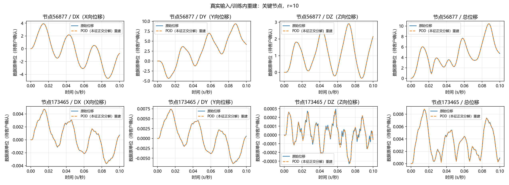
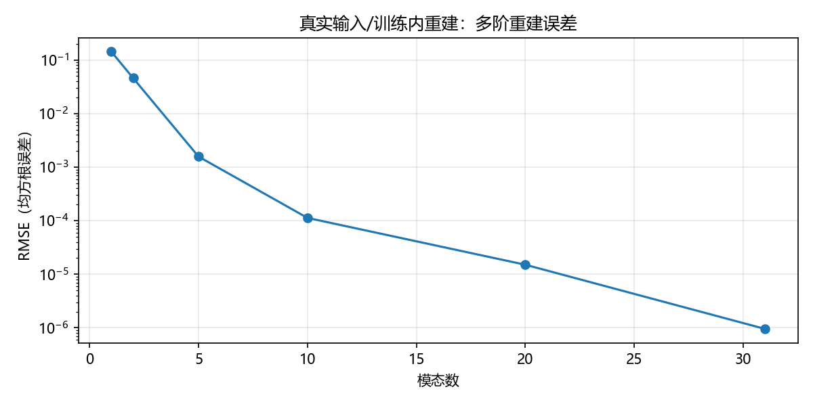

# 安世亚太机械臂瞬态位移降阶 V0.1

使用 Snapshot-POD（时间快照本征正交分解）完成 **267801个节点、101个时间点、DX/DY/DZ三方向位移**的降阶与重建。全部数值计算在Ubuntu上执行，18项自动化测试通过。

本仓库提供代码、实测结果和汇报图表；原始数据单独存放。实验采用同一工况的全部已知时间帧学习基底并重建，结果属于**训练内压缩与重建**。

## 先看这些文件

- [PPT素材索引与建议讲述顺序](docs/PPT_MATERIALS.md)
- [完整实验报告](outputs/v01/report.md)
- [多阶指标表](outputs/v01/rank_metrics.csv)
- [机器可读摘要](outputs/v01/summary.json)
- [Ubuntu运行与输入说明](docs/RUNNING.md)

## 真实计算结果

|模态数|全场相对L2误差|均方根误差|理论模型存储比|
|---:|---:|---:|---:|
|1|15.1698%|0.142398|25.25∶1|
|2|4.87905%|0.0457994|16.83∶1|
|5|0.167286%|0.00157031|8.42∶1|
|10|**0.0120012%**|**0.000112655**|**4.59∶1**|
|20|0.00160268%|0.0000150442|2.40∶1|
|31|0.000101550%|0.000000953249|1.58∶1|

有效秩为31，评估1、2、5、10、20、31阶；40阶超过有效秩。位移及绝对误差均使用数据原单位，待客户确认。

10阶保留99.99999824%的中心化快照能量，最大节点位移向量误差0.00227075。全场峰值位于节点56877、0.088秒，幅值10.42835352；10阶重建峰值幅值绝对误差0.000114599，峰值时刻误差0秒。

总计算时间127.60秒：流式解析106.46秒、POD（本征正交分解）5.46秒、重建评估12.54秒、绘图1.51秒；峰值内存660.88 MiB（二进制兆字节）。不包含上传时间，也没有与原有限元求解耗时比较。

理论存储比使用原始单精度快照字节数，除以双精度均值、指定阶数模态和时间系数的字节数；不代表整个结果目录的实际压缩比或求解加速比。

## 可直接使用的图





另有[累计能量图](outputs/v01/01_pod_energy.png)和[逐帧误差图](outputs/v01/02_reconstruction_rmse.png)。

## 快速运行

```bash
git clone https://github.com/Lin-zh-handsome/anshiyatai.git
cd anshiyatai
bash scripts/bootstrap_ubuntu.sh
# 已知低秩构造、数据异常与数值正确性验证
bash scripts/smoke_test.sh
# 将真实数据按docs/RUNNING.md说明放到本地data目录后
bash run_v01.sh
```

代码采用按节点编号对齐的流式解析和磁盘映射，只分解101×101时间内积矩阵，不构造803403×803403空间矩阵。

## 范围

当前结果不评价新载荷响应预测、跨工况泛化或强非线性稳定性。精确载荷、应力、速度、加速度数值未提供，本版没有计算或编造这些数值。合成验证结果单独标记在`outputs/synthetic/`。
